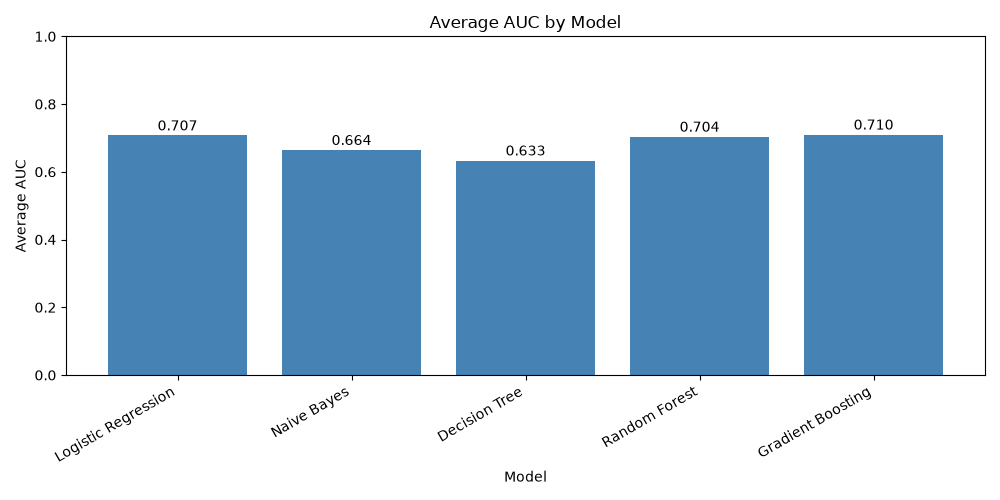
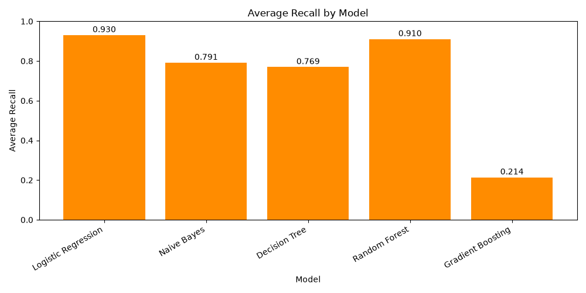

# Loan Default Prediction Model

A Python project that explores how well several machine learning classifiers can identify loans with `loan_status = 1`. It compares five models across ten train/test splits and reports metrics that show different tradeoffs, especially between finding more positive cases and avoiding false alarms.

> **Note:** This repository is a model comparison and analysis project. The script trains and evaluates models; it does not save a trained model or provide a deployed prediction service.

## 📊 Project overview

The analysis uses **27,003 loan records**. The target, `loan_status`, is binary:

| `loan_status` | Records | Share |
|---|---:|---:|
| 0 | 23,026 | 85.27% |
| 1 | 3,977 | 14.73% |

The classes are imbalanced, so accuracy alone does not describe model performance well. The script also reports recall, precision, F1 score, balanced accuracy, specificity, ROC AUC, average precision, and Matthews correlation coefficient (MCC).

## 🗂️ Repository contents

```text
Loan_default_prediction_model/
├── image/
│   ├── Average_AUC_chart.png
│   └── Average_recall_chart.png
├── loan_dataset.csv
├── loan_default_predictor.py
└── output.txt.txt
```

- **`loan_dataset.csv`** — loan records used by the analysis.
- **`loan_default_predictor.py`** — loads and prepares the data, trains the classifiers, evaluates them, prints results, and displays charts.
- **`output.txt.txt`** — captured console output from a run, including data summaries and model results.
- **`image/`** — saved charts comparing mean AUC and mean recall.

## ⚙️ How the analysis works

1. **Loads and inspects the data.** The script reads `loan_dataset.csv` and prints an overview of the records, columns, target counts, and missing values.
2. **Removes selected columns.** It drops identifiers, descriptive text, location details, and payment information that could be unnecessary for prediction or reveal information from after loan issuance.
3. **Handles missing values and formats.** Employment length and bankruptcy records receive fill values; two highly incomplete delinquency/record-history columns are removed. Interest rate and revolving utilization are converted from percentage strings to numbers.
4. **Prepares features.** Numeric fields are standardized. Several categorical fields are one-hot encoded, while loan sub-grade and employment length are ordinal encoded.
5. **Trains and evaluates five classifiers.** The models are Logistic Regression, Gaussian Naive Bayes, Decision Tree, Random Forest, and Gradient Boosting.
6. **Repeats the comparison across ten splits.** Each split uses an 80/20 train/test division with stratification. The random seeds are `0, 5, 10, …, 45`.
7. **Summarizes results.** The script prints scores for each split, mean scores, per-metric wins, and confusion matrices. It then displays average AUC and average recall charts.

The script uses a **0.30 probability threshold** to turn predicted probabilities into class predictions. ROC AUC and average precision are calculated from probabilities; most other reported metrics use the thresholded predictions.

## 🧠 Models compared

- **Logistic Regression** — a linear classification baseline, configured with class weighting.
- **Gaussian Naive Bayes** — a probabilistic classifier based on feature distributions.
- **Decision Tree** — a tree-based model with limits on tree depth and leaf size.
- **Random Forest** — an ensemble of decision trees.
- **Gradient Boosting** — a boosted tree ensemble.

## 📈 Average test results

The following scores are means across the ten test splits. Except for test accuracy, the scores describe the positive class (`loan_status = 1`) or the model’s ability to distinguish the two classes.

| Model | Test accuracy | ROC AUC | Recall | Precision | F1 | Balanced accuracy | Specificity | MCC | Average precision |
|---|---:|---:|---:|---:|---:|---:|---:|---:|---:|
| Logistic Regression | 0.3455 | 0.7073 | **0.9303** | 0.1753 | 0.2950 | 0.5874 | 0.2445 | 0.1499 | 0.3010 |
| Naive Bayes | 0.4797 | 0.6642 | 0.7913 | 0.1925 | **0.3095** | **0.6086** | 0.4259 | 0.1576 | 0.2469 |
| Decision Tree | 0.4549 | 0.6332 | 0.7693 | 0.1815 | 0.2937 | 0.5850 | 0.4007 | 0.1245 | 0.2264 |
| Random Forest | 0.3907 | 0.7035 | 0.9103 | 0.1835 | 0.3055 | 0.6057 | 0.3010 | 0.1688 | 0.2891 |
| Gradient Boosting | **0.8334** | **0.7098** | 0.2137 | **0.3827** | 0.2741 | 0.5770 | **0.9404** | **0.1988** | **0.3023** |

### Reading the results

- **Gradient Boosting** has the highest mean test accuracy, precision, specificity, ROC AUC, average precision, and MCC in the saved output.
- **Logistic Regression** has the highest mean recall: it identifies more of the positive cases, but has low precision and specificity, so it also produces many false positives.
- **Naive Bayes** has the highest mean F1 score and balanced accuracy.
- Gradient Boosting’s **83.34% accuracy should not be read on its own**: its mean recall is 21.37%, meaning it misses many positive cases at the selected threshold.

The comparison shows that the “best” model depends on which errors matter most. A lower threshold can find more positive cases while also increasing false positives; this project uses one threshold and does not tune it to a specific real-world cost.

## 🖼️ Charts

### Mean ROC AUC by model



### Mean recall by model



## 🚀 Run the project

Run these commands from a terminal:

```bash
git clone https://github.com/dashnilanchal00-beep/Loan_default_prediction_model.git
cd Loan_default_prediction_model
python -m venv .venv
```

Activate the environment:

**Windows PowerShell**

```powershell
.venv\Scripts\Activate.ps1
```

**macOS / Linux**

```bash
source .venv/bin/activate
```

Install the libraries used by the script and run it:

```bash
python -m pip install pandas numpy matplotlib scikit-learn
python loan_default_predictor.py
```

Keep `loan_dataset.csv` in the project directory when running the script. It prints the analysis and evaluation results in the terminal, then opens the AUC and recall charts.

## 🧰 Tools used

- Python
- pandas
- NumPy
- scikit-learn
- Matplotlib

## ⚠️ Limitations

- The results depend on the supplied dataset, feature preparation, model settings, and fixed 0.30 threshold.
- The positive class is evaluated as `loan_status = 1`; confirm the source dataset’s label definitions before interpreting it as a particular loan outcome.
- The saved results are a comparison on repeated random splits, not evidence of performance on future loan applications or a separate external dataset.
- This project is for learning and experimentation. It should not be used on its own to make lending decisions.
